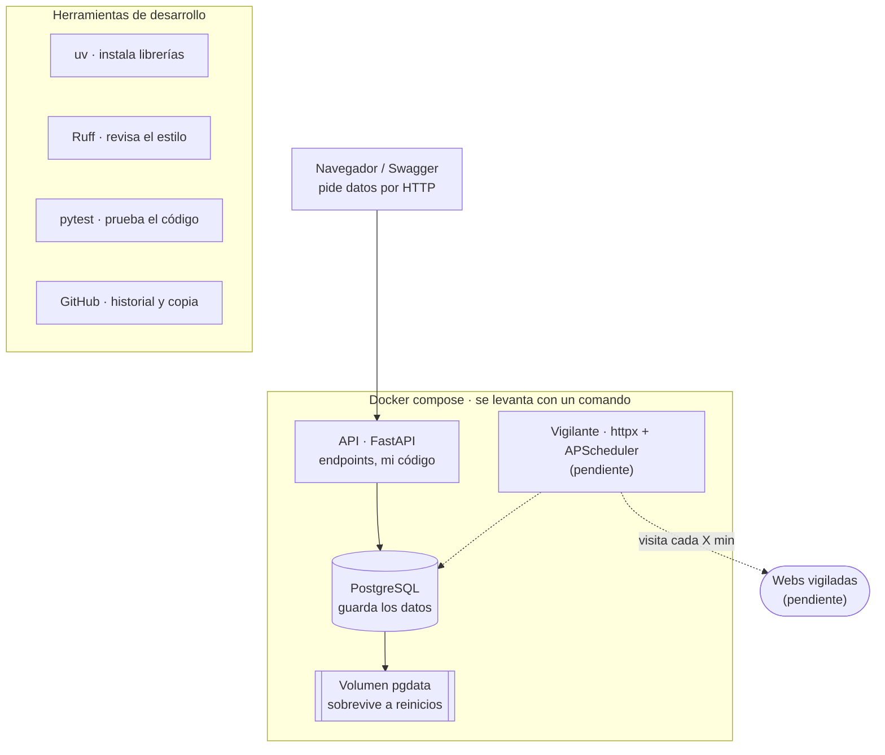

# Devlog — Service Monitor

Notas de desarrollo: qué se ha hecho en cada paso, por qué, y los conceptos que han ido saliendo.

---

## Qué es este proyecto (en una frase)

Le das al monitor una lista de webs o APIs; él las visita cada X minutos, apunta cada resultado (si respondió, cuánto tardó) y avisa por Telegram si alguna cae.

## Mapa del proyecto



- **API** = el mostrador: por ahí se dan de alta webs, se consulta el historial... Es mi código.
- **PostgreSQL** = el archivador: guarda la lista de webs (`services`) y cada comprobación hecha. Sale de la imagen oficial de Postgres; sus datos viven en el volumen.
- **Docker compose** = la caja que monta las piezas juntas en cualquier ordenador.
- **Vigilante** = la pieza que falta: cada X minutos visita las webs y apunta el resultado.
- **Herramientas** = el taller: uv instala, Ruff ordena, pytest comprueba, GitHub guarda y enseña.

## Hoja de ruta

| Paso | Qué | Estado |
|---|---|---|
| 1 | Esqueleto del repo y primer endpoint | ✅ Hecho |
| 2 | Base de datos y migraciones | 🔄 En curso (falta Alembic) |
| 3 | CRUD de servicios + comprobaciones y programación (el corazón) | ⏳ |
| 4 | Tests y CI (GitHub Actions) | ⏳ |
| 5 | Autenticación JWT con roles | ⏳ |
| 6 | Front mínimo (React + TS + Tailwind + Recharts) | ⏳ |
| 7 | Despliegue (DigitalOcean) | ⏳ |
| Extra | Redis, AWS | opcional |

## Método de trabajo (desde el paso 2)

1. Antes de cada paso: dónde encaja en el mapa y uno o dos conceptos clave.
2. Código con comentarios breves; lo mecánico se copia, las dudas se preguntan.
3. Al cerrar cada paso: tres preguntas tipo entrevista, respondidas con mis palabras y corregidas. Van a la sección "Preguntas de entrevista" de este log.

Objetivo: poder explicar el proyecto en una entrevista (el porqué), aunque no sepa escribir de memoria cada línea (el cómo).

---

## Paso 1 · Esqueleto del repo y primer endpoint (19–23 nov 2026)

### Qué se hizo

- Entorno preparado: WSL 2 (Ubuntu 22.04), Docker Desktop, uv 0.13.9, VS Code con la extensión WSL.
- Proyecto creado con `uv init`, dependencias añadidas con `uv add`.
- Primer endpoint `GET /health`, con su test.
- La app corre en Docker y se levanta con `docker compose up`.
- Primer commit y repo público: github.com/zellorz/service-monitor

### Estructura

```
service-monitor/                ← raíz: config del proyecto, Docker, Git
├── pyproject.toml              ficha del proyecto + config de Ruff y pytest
├── uv.lock                     versiones exactas de todas las dependencias
├── .python-version             "3.12"
├── src/service_monitor/        ← el código Python
│   ├── main.py                 crea la app y enchufa los routers
│   ├── core/config.py          configuración leída de variables de entorno
│   └── api/routes/health.py    primer endpoint
├── tests/test_health.py
├── Dockerfile · .dockerignore · compose.yaml
├── .env.example                plantilla de variables (va a Git)
├── .env                        valores reales y secretos (NO va a Git)
└── README.md
```

Regla práctica: configuración del proyecto en la raíz; código Python en `src/service_monitor`.

### El código, archivo a archivo

- **`core/config.py`**: clase `Settings` (pydantic-settings). Cada atributo es una variable de configuración con tipo y valor por defecto; se sobrescribe desde el entorno o el `.env`. Una sola instancia, `settings`, que importa todo el código.
- **`api/routes/health.py`**: un `APIRouter` con `GET /health`, que devuelve un `HealthResponse` (modelo Pydantic). La anotación `-> HealthResponse` hace que FastAPI valide la respuesta y la documente en Swagger. Patrón que se repetirá en todos los endpoints.
- **`main.py`**: crea `app = FastAPI(...)` y le añade el router.
- **`tests/test_health.py`**: `TestClient` llama a la app en memoria (sin servidor) y comprueba código 200 y contenido.
- **`Dockerfile`**: `python:3.12-slim` + uv fijado a 0.13.9. Dos capas: primero dependencias, luego código, para que los builds sean rápidos. Arranca con `fastapi run` (producción).
- **`compose.yaml`**: servicio `api`, puerto 8000, lee `.env`. Aquí se añadirá Postgres.

### Decisiones y por qué

- **Estructura `src/`** (la genera uv 0.13 por defecto): el código se instala como paquete en el `.venv`, así `from service_monitor...` funciona igual en tests, Docker y terminal. Es la estructura recomendada por la guía oficial de empaquetado de Python.
- **`uv.lock` en Git, `.venv` fuera**: el lock garantiza las mismas versiones en todas partes; el `.venv` se regenera en cada máquina.
- **`.env` fuera de Git, `.env.example` dentro**: los secretos se quedan en cada máquina; la plantilla documenta qué variables existen.
- **`.dockerignore`**: evita meter el `.venv` local o el `.env` en la imagen.
- **Docker desde el día 1**: requisito del proyecto (`git clone` + `docker compose up`); más fácil mantenerlo desde el principio que adaptarlo al final.
- **Ruff y tests desde el primer endpoint**: el código nace limpio y comprobado; GitHub Actions solo tendrá que repetir lo mismo.
- **Conventional Commits** (`feat:`, `fix:`, `chore:`, `docs:`, `test:`, `refactor:`): historial legible.

---

## Paso 2 · Base de datos y migraciones (26 nov 2026, en curso)

### Qué se ha hecho
- **Postgres en compose**: segundo servicio `db` con la imagen oficial `postgres:18`, volumen `pgdata`, healthcheck (`pg_isready`) y la API esperando a que esté sana (`depends_on: service_healthy`).
- **Variables** `POSTGRES_USER`, `POSTGRES_PASSWORD`, `POSTGRES_DB` en `.env` / `.env.example`.
- **Librerías**: `sqlalchemy` (ORM), `psycopg[binary]` (driver), `alembic` (migraciones).
- **`config.py`**: campos de Postgres obligatorios + propiedad `database_url` que construye la URL de conexión.
- **Host**: desde mi terminal la BD está en `localhost`; dentro de compose, en `db` (nombre del servicio). Por eso compose pasa `POSTGRES_HOST: db` a la API.
- **`core/db.py`**: `engine` (conexiones), `SessionLocal` (fábrica de sesiones), `Base` (madre de los modelos) y `get_db()` (una sesión por petición).
- **`/health`** ahora hace `SELECT 1`: si la BD no responde, devuelve **503** en lugar de reventar. Probado parando y arrancando `db`.
- **Primer modelo** `Service` (tabla `services`): `id`, `name`, `url`, `interval_minutes`, `is_active`, `created_at`.
- Pendiente: Alembic y primera migración.

### Decisiones y por qué
- **SQLAlchemy síncrono** (sin async): más fácil de entender y depurar; de sobra para este volumen.
- **URL construida en `Settings`** a partir de variables sueltas: un solo sitio para la configuración; la contraseña nunca aparece en el código.
- **`server_default=func.now()`** para `created_at`: la fecha la pone Postgres, fiable aunque escriban varias máquinas.
- **Modelos en `models/`, schemas en `schemas/`**: lo que se guarda no es lo mismo que lo que se enseña.

---

## Conceptos clave

### Base de datos, tabla, SQL
Postgres guarda los datos en **tablas** (filas y columnas, como una hoja de cálculo). Se le habla en **SQL**: `SELECT * FROM services WHERE interval_minutes = 5;`

### ORM (SQLAlchemy)
Traductor entre Python y las tablas. Una clase (`Service`) = una tabla (`services`); un objeto = una fila. Escribo Python y SQLAlchemy genera el SQL.

### Driver (psycopg)
La pieza que lleva el SQL hasta Postgres por la red y trae la respuesta. SQLAlchemy redacta, psycopg hace de mensajero.

### Migración (Alembic)
Archivo que describe un cambio en la **estructura** de la BD ("crea la tabla services", "añade la columna email"). Es como Git para la estructura: numeradas, en orden, y Alembic sabe cuáles faltan en cada máquina.

### Modelo vs schema
| | Modelo (SQLAlchemy) | Schema (Pydantic) |
|---|---|---|
| Representa | Una tabla | La forma del JSON que entra/sale de la API |
| Ejemplo | `Service` | `HealthResponse`, `ServiceCreate` |
| Carpeta | `models/` | `schemas/` |

### Volumen (Docker)
Un contenedor es desechable: si se borra, se borra lo de dentro. Un volumen es almacenamiento que Docker guarda **fuera** del contenedor. `docker compose down` no lo toca; `docker compose down -v` sí (y con él, los datos).

### Engine, sesión
- **Engine**: sabe dónde está la BD y mantiene un pool de conexiones reutilizables. Uno para toda la app.
- **Sesión**: una "conversación" con la BD (abrir, consultar/cambiar, cerrar). Una por petición.

### Dependencias en FastAPI (`Depends`)
`db: Annotated[Session, Depends(get_db)]` = "antes de llamar a esta función, ejecuta `get_db` y pásame lo que dé". FastAPI abre la sesión, la entrega, y la cierra al acabar (eso hace el `yield`). Se usará en todos los endpoints que toquen la BD.

### Healthcheck y 503
Un health check responde "¿estás bien?". Si algo de lo que depende la API falla (la BD), responde **503 Service Unavailable**: la API vive, pero no puede trabajar. Es lo que mirará el servidor de despliegue.

### Endpoint
Una dirección de la API que responde a una petición concreta: **método + ruta**. Como las ventanillas de una oficina, cada una atiende un trámite.

| Método | Significa | Ejemplo |
|---|---|---|
| GET | leer | `GET /services` — listar servicios |
| POST | crear | `POST /services` — dar de alta uno |
| PUT / PATCH | modificar | `PATCH /services/5` |
| DELETE | borrar | `DELETE /services/5` |

En el código, cada endpoint es una función con un decorador (`@router.get("/health")`). Swagger (`/docs`) muestra la lista.

Códigos de respuesta habituales: **200** OK · **404** no existe · **422** datos inválidos · **500** error en mi código.

### Imagen y contenedor (Docker)
Como componente maestro e instancias en Figma:
- **Dockerfile** → las instrucciones para construir el maestro.
- **Imagen** → el maestro construido y congelado (Linux + Python + librerías + mi código). Se crea con `docker build`.
- **Contenedor** → una instancia de la imagen en marcha. Se crea con `docker run` / `docker compose up`.

Si cambio código, hay que reconstruir la imagen (`--build`).

### "Entorno" significa tres cosas distintas
1. **Variables de entorno**: pares `NOMBRE=valor` que el sistema entrega a un programa al arrancar.
2. **`.env`**: archivo de texto con esas variables apuntadas. Compose lo lee y se las pasa al contenedor.
3. **"Entorno local / producción"**: dónde corre la app (mi PC, el servidor...).

Y además:
- **`Settings`** (`config.py`): el código que lee las variables, valida su tipo y las ofrece a la app.
- **`.venv`** ("virtual environment"): nada que ver con lo anterior. Carpeta con Python y las librerías de este proyecto.

Cadena: `.env` → variables de entorno → `Settings` → mi código.

### Por qué `.env` es secreto
Ahí irán la contraseña de la base de datos, la clave del JWT (quien la tenga puede fabricarse un login de admin) y el token de Telegram. El repo es público, hay bots que rastrean GitHub buscando claves, y Git guarda el historial aunque se borre el archivo. Además, cada máquina tiene sus propios valores.

### `0.0.0.0` vs `127.0.0.1`
`127.0.0.1` (= `localhost`) significa "solo esta máquina". Dentro de un contenedor, eso es solo el contenedor: no se podría entrar desde fuera. `0.0.0.0` significa "acepta conexiones de cualquier sitio".

---

## Chuleta de comandos

### Proyecto (desde la raíz)
```bash
uv add <paquete>                              # añadir dependencia
uv add --dev <paquete>                        # dependencia solo de desarrollo
uv sync                                       # instalar todo según uv.lock (p. ej. en el portátil)
uv run fastapi dev src/service_monitor/main.py   # servidor en desarrollo (recarga sola)
uv run pytest -v                              # tests
uv run ruff check --fix .                     # lint y arreglos automáticos
uv run ruff format .                          # formatear
```

### Docker
```bash
docker compose up --build      # construir y arrancar
docker compose up -d           # en segundo plano
docker compose logs -f         # ver logs
docker compose down            # parar
docker compose config          # ver la config final (con .env aplicado)
```

### Git
```bash
git status                     # qué ha cambiado
git add .                      # preparar cambios
git commit -m "tipo: mensaje"  # guardar
git push                       # subir a GitHub
git log --oneline              # historial
```

### Terminal
- **Tab** autocompleta · **↑/↓** comandos anteriores · **Ctrl+L** limpia
- **Ctrl+C** cancela (no copia; copiar = Ctrl+Shift+C)
- `rm` borra sin papelera
- `cp origen destino` copia · `cat archivo` muestra contenido · `pwd` dónde estoy

### VS Code
- **Ctrl+P** buscar archivo · **Ctrl+Shift+P** paleta de comandos
- **Ctrl+ñ** terminal · papelera = cerrar terminal, X = solo ocultar
- **Ctrl+Shift+M** panel de problemas · **Ctrl+Shift+V** vista previa Markdown
- Punto blanco en la pestaña = sin guardar

### Postgres
```bash
docker compose exec db psql -U monitor -d monitor   # entrar en la consola de Postgres
# dentro de psql:
\l          # listar bases de datos
\dt         # listar tablas
\q          # salir
# SQL siempre termina en ;   (si el prompt es monitor-# está esperando el ;)
docker compose logs db       # qué ha dicho Postgres (primer sitio a mirar si falla)
docker compose stop db / start db   # parar/arrancar sin borrar
```

### Lecciones del paso 1
- Mirar el prompt antes de ejecutar (`~$` vs `service-monitor$`).
- Archivo sin guardar ≠ archivo en disco. Auto Save activado.
- Los comandos van en la terminal; el contenido, en los archivos.
- Ctrl+C solo funciona con el foco en la terminal.
- En YAML, la indentación es la sintaxis (2 espacios, nunca tabuladores).

### Lecciones del paso 2
- Si un contenedor falla, `docker compose logs <servicio>`: el error suele decirlo literalmente.
- El puerto 8000 solo lo puede usar un programa: o `fastapi dev` o `docker compose`, no los dos.
- JSON: coma entre elementos, nunca después del último.

---

## Preguntas de entrevista

Para responder con mis palabras (2-3 frases) y corregir con Claude.

### Paso 1
1. ¿Por qué usas Docker en un proyecto tan pequeño?
2. ¿Qué es el `.env` y por qué no está en el repo?
3. ¿Para qué sirven Ruff y pytest si el código ya funciona?

### Paso 2
1. ¿Qué es un ORM y qué ganas usándolo frente a escribir SQL a mano?
2. ¿Por qué usas migraciones en lugar de crear las tablas a mano?
3. ¿Qué pasa con tus datos si borras el contenedor de Postgres? ¿Por qué?

---

## Próximo paso
**Paso 2 (cierre)**: Alembic y primera migración, que crea la tabla `services` en Postgres.
